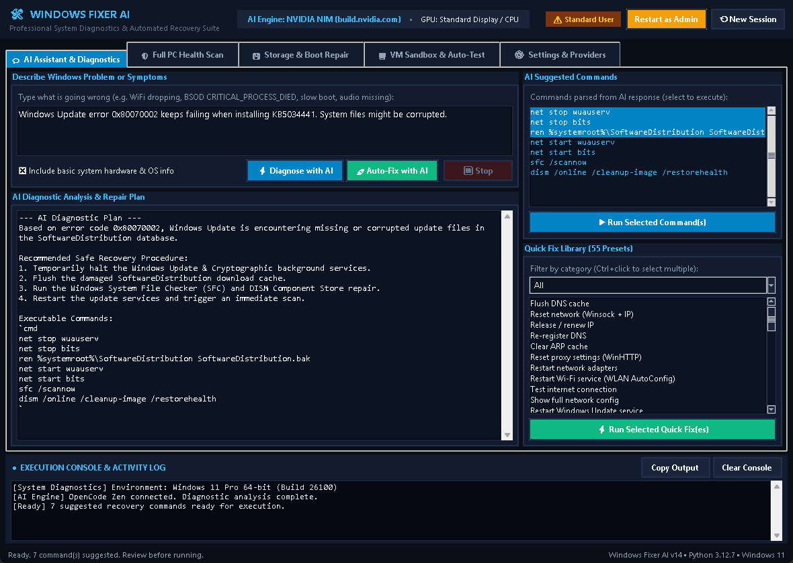
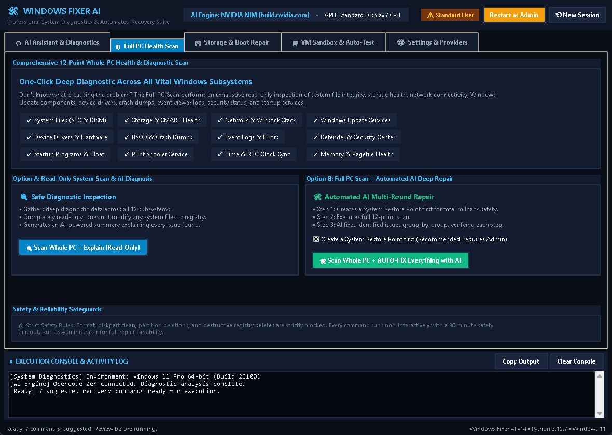
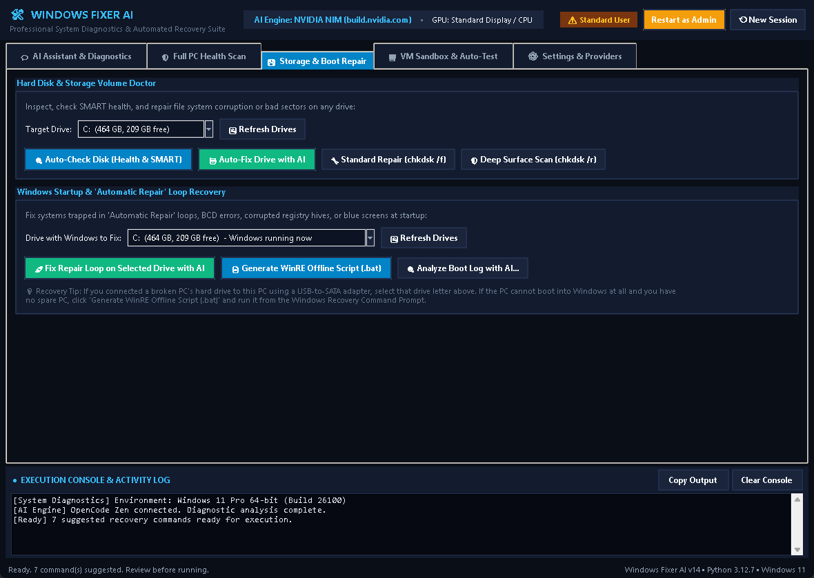
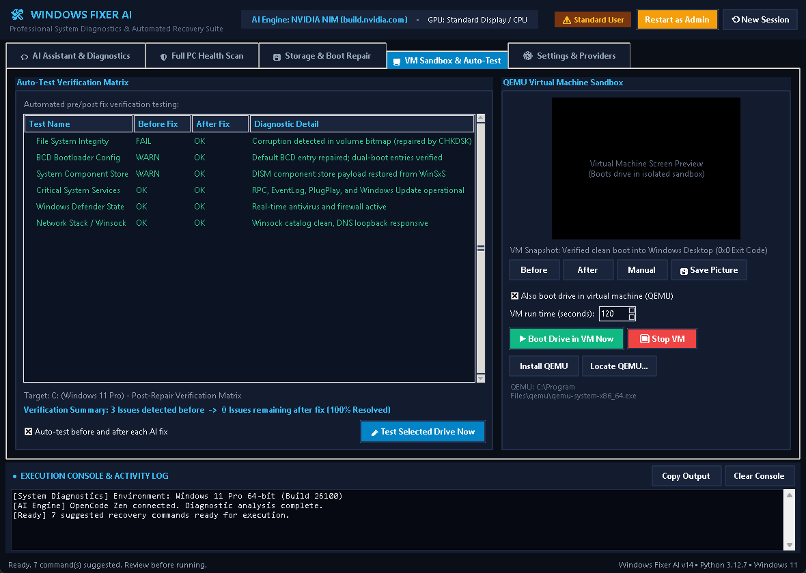
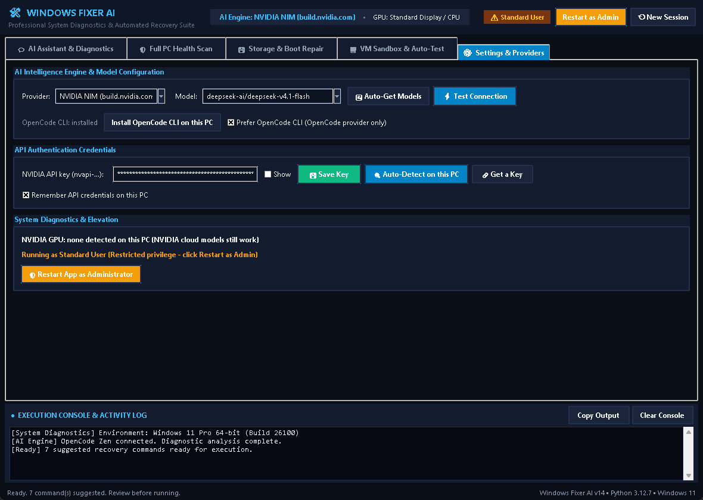

# Windows Fixer AI 🛠

> **Professional Windows Diagnostics, Automated Repair & Recovery Suite** powered by OpenCode Zen and NVIDIA NIM models. Built entirely with the Python standard library—no third-party dependencies required.

---

## 🌟 Overview

**Windows Fixer AI** is an advanced, automated diagnostic and system recovery application designed to resolve Windows 10 & 11 issues—from subtle network and update glitches to full boot loops and disk corruption.

The application features a modern **Windows 11 Fluent Slate Dark Theme** with native High-DPI scaling, an executive header bar with live status badges, a 5-tab workspace, and a persistent execution console.

---

## 📸 Interface Screenshots

| **💬 AI Assistant & Diagnostics** | **🛡 12-Point Full PC Health Scan** |
| :---: | :---: |
| [](screenshots/01_ai_assistant.png) | [](screenshots/02_full_pc_scan.png) |

| **💾 Storage & Boot-Loop Recovery** | **🖥 QEMU Sandbox & Auto-Test Matrix** |
| :---: | :---: |
| [](screenshots/03_storage_boot_repair.png) | [](screenshots/04_vm_sandbox_test.png) |

| **⚙ AI Providers & System Settings** |
| :---: |
| [](screenshots/05_settings_providers.png) |

---

## 🚀 Key Features

### 1. 💬 AI Assistant & Diagnostics
- **Interactive Diagnosis**: Describe any issue in natural language (e.g., *"WiFi drops randomly"*, *"BSOD CRITICAL_PROCESS_DIED"*, *"Windows Update error 0x80070002"*).
- **Auto-Fix Mode**: Let the AI automatically execute suggested commands sequentially, inspect their output, and verify repair results in up to 6 rounds.
- **Review & Execution Modal**: Dedicated review dialog with line numbering, sensitive operation alerts, and one-click clipboard copying.
- **HTML Diagnostic Report Exporter**: Export complete findings, system specs, AI solution plans, and console logs into standalone dark-mode HTML reports.
- **Live Search & Quick Fix Library**: 55 built-in presets with instant real-time keyword search across Network, Windows Update, System Files (SFC/DISM), Cleanup, Drivers, and Security.

### 2. 🛡 Full PC Health Scan
- **12-Point System Inspection**:
  - System file integrity (SFC & DISM)
  - Hard drive SMART health & NTFS/FAT dirty-bits
  - Network stack, DNS & Winsock
  - Windows Update components & background services
  - Device Manager & hardware driver statuses
  - BSOD crash dumps & Windows Error Reporting (WER)
  - Event Viewer critical system logs
  - Windows Defender & Security Center health
  - Startup bloat & background applications
  - Print Spooler subsystem
  - Time & RTC synchronization
  - Memory & pagefile health
- **Two Execution Modes**:
  - **Option A (Read-Only Scan)**: Deep inspection with AI-generated breakdown; modifies nothing.
  - **Option B (Scan + Auto-Fix Everything)**: Automatically creates a **System Restore Point** first, then repairs issues group-by-group with verification.

### 3. 💾 Storage & Boot-Loop Recovery
- **Storage Volume Doctor**: Run SMART checks, standard repairs (`chkdsk /f`), deep surface scans (`chkdsk /r`), or AI drive repairs on any selected drive.
- **Startup & "Automatic Repair" Loop Rescue**:
  - Target the active Windows installation or an offline broken drive attached via USB/SATA.
  - Automated AI repair loop tailored for offline Windows directories.
  - Generate standalone offline recovery scripts (`repair_boot_loop.bat`) for Windows Recovery Environment (WinRE) Command Prompt.
  - Integrated CBS / SrtTrail log analyzer.

### 4. 🖥 QEMU Sandbox & Auto-Test Studio
- **Pre & Post Fix Verification Matrix**: Runs automated test checks before and after each fix to display exact deltas (OK, WARN, FAIL).
- **QEMU Throw-Away Virtual Machine**: Boots the drive in an isolated snapshot VM (read-only, no network, zero disk writes) and reads the screen using Windows OCR to accurately detect boot symptoms before applying fixes.

### 5. ⚙ AI Provider & Model Flexibility
- **OpenCode Zen (Free)**: Zero-setup access to free models (e.g., `big-pickle`, `mimo-v2.5-free`, `deepseek-v4-flash-free`, `nemotron-3-ultra-free`).
- **NVIDIA NIM Cloud**: Access high-performance reasoning models (`deepseek-ai/deepseek-v3.2`, `meta/llama-3.3-70b-instruct`, etc.) using your NVIDIA API key.
- **Auto-Detection**: Scans environment variables and local config files to autofill API credentials automatically.

---

## 🔒 Safety & System Safeguards

- **Strict Command Blacklist**: Destructive commands (`format`, `diskpart clean`, partition deletes, recursive system folder removals, destructive registry wipes) are strictly blocked.
- **Execution Safeguards**: Commands run non-interactively with a 30-minute safety timeout to prevent hanging processes.
- **System Restore Point**: Integrated restore point creation before multi-round automated repair routines.

---

## 📦 Requirements & Installation

- **Operating System**: Windows 10 or Windows 11
- **Python**: Python 3.8 or higher
- **Dependencies**: **Zero third-party packages required** (pure Python standard library: `tkinter`, `ctypes`, `subprocess`, `urllib`, `threading`, etc.).

### Running the Application

1. Clone the repository:
   ```cmd
   git clone https://github.com/sexykiller14/window-fixer-ai.git
   cd window-fixer-ai
   ```

2. Run via launcher or directly with Python (for best repair capabilities, launch as Administrator):
   - **Double-click** `run.bat` (or right-click -> *Run as administrator*)
   - Or run from command prompt:
     ```cmd
     python windows_fixer.py
     ```

*(You can also click **Restart as Admin** from the header inside the app at any time).*

---

## 📄 License

This project is open-source and available under the [MIT License](LICENSE).
